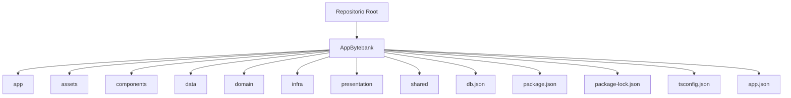
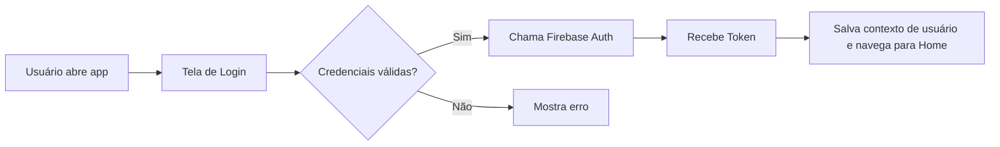

# Tech Challenge Fiap 3
##### Repositorio para mobile

## Tecnologias utilizadas no projeto

#### • Node version 20.19.0
#### • React Native
#### • Figma
#### • Firebase

---------------------------------------------------------------

# Orietações para execução do projeto

Para executar o projeto, siga os passos abaixo:

**instalação de dependencia abra o terminal e execute o comando abaixo**

- npm install

**Subida do projeto no expo abra o terminal e execute o comando abaixo**

- npm run start

*O projeto será executado na porta 8081*

Voce pode acessar via web na porta indicada , ou no aplicativo Expo dev . Instale o aplicativo no seu app strore e depois de instalado aponte a campera do celular no qr code para que a aplicaçao [...]

Para que o app possa rodar dentro do celular , voce precisa pegar o ip da sua maquina 

apertando windows + r e depois digite no prompt ipconfig 

pegue o IPV4 correspondente siga o caminho

AppBytebank >> financeiro >> util.services.tsx

e coloque o ip da sua maquina na constante *const LOCAL_IP*

**Também é possível rodar o projeto via Emulador do VisualStudio**

- npm run start
- Opção "a" (Android)

Obs: É necessário ter o visual studo instalado e o emulador devidamente configurado em sua máquina.

**O projeto já possui um usuário criado para testes, para realizar o login, utilize o usuário de teste abaixo**

usuario: teste@email.com
senha: 123456

---

## Estrutura do projeto

Observação importante: este repositório organiza o código dentro da pasta principal `AppBytebank`. Não existe a pasta `src` — a estrutura segue uma separação por camadas/feature dentro de `AppBytebank`.

### Principais pastas e responsabilidades (mapeamento real)
- AppBytebank/app: ponto de entrada / configuração do app (relacionado ao Expo/app.json).
- AppBytebank/presentation: telas e containers (camada de UI — equivalente a screens).
- AppBytebank/components: componentes reutilizáveis (botões, inputs, headers).
- AppBytebank/shared: utilitários, estilos, temas e wrappers compartilhados.
- AppBytebank/domain: regras de negócio, modelos e casos de uso.
- AppBytebank/infra: implementações infra (serviços, adaptadores, integrações com APIs ou Firebase).
- AppBytebank/data: dados estáticos, fixtures ou mapeamentos usados pela aplicação.
- AppBytebank/assets: imagens, fontes e arquivos estáticos.
- AppBytebank/db.json: mock local / dados para desenvolvimento.
- AppBytebank/package.json / package-lock.json / tsconfig.json / app.json: configurações e dependências do projeto.

### Observações rápidas sobre uso
- Para rodar/inspecionar scripts, abra a pasta `AppBytebank` e verifique o `package.json` localizado ali (alguns comandos podem ter paths relativos a essa pasta).
- Se houver referências a `LOCAL_IP` ou outro utilitário, procure em `AppBytebank/shared` ou em arquivos dentro de `AppBytebank` (ex.: util/services) — mantenha esses arquivos atualizados quando usar dispositivo físico.
- A organização por camadas (presentation → domain → infra) facilita testes e separação de responsabilidades: presentation consome domain, que por sua vez usa infra.

## Arquitetura e fluxos

O app está organizado com separação por responsabilidades: UI (components/screens), navegação (navigation), serviços (services) e lógica compartilhada (hooks/contexts). Abaixo um fluxo simplificado de autenticação.

## Principais pastas e responsabilidades

- src/components: componentes reutilizáveis (Botões, Inputs, Headers)
- src/screens: telas da aplicação (Login, Home, Perfil, etc.)
- src/navigation: configuração do React Navigation e rotas
- src/services: integração com Firebase e APIs externas
- src/contexts: providers de contexto (AuthContext, ThemeContext)
- src/hooks: hooks customizados utilizados pela aplicação
- src/utils: funções utilitárias e constantes (ex: LOCAL_IP)
- assets: imagens, fontes e arquivos estáticos

## Scripts úteis

- npm install: instala dependências
- npm run start: inicia o Metro/Expo
- npm run android (se configurado): abre no emulador Android
- npm run ios (se configurado): abre no simulador iOS

Ajuste: alguns scripts podem depender da configuração local do Expo/React Native — verifique package.json para a lista completa.

## Configuração do Firebase

Se o projeto depende do Firebase, verifique os arquivos dentro de src/services/firebase. Para configurar o Firebase em sua máquina:

1. Crie um projeto no console do Firebase
2. Adicione um app (Android/iOS/Web) e copie as credenciais (apiKey, authDomain, projectId, etc.)
3. Coloque as credenciais no arquivo de configuração indicado em src/services/firebase/config.js (ou .ts). NÃO commit essas chaves em repositórios públicos — use variáveis de ambiente quando possível.

## Variáveis de ambiente

- LOCAL_IP: IP da sua máquina para uso em chamadas locais (conforme instruções existentes)
- FIREBASE_API_KEY, FIREBASE_AUTH_DOMAIN, FIREBASE_PROJECT_ID, etc.: credenciais do Firebase

Recomendo criar um arquivo .env.local (adicionado ao .gitignore) com essas chaves em desenvolvimento.

## Testes e qualidade

- Se existirem testes (jest, testing-library), execute com: npm test
- Utilize linters (eslint, prettier) se estiverem configurados: npm run lint

## Boas práticas para contribuições

- Abra uma issue descrevendo a feature/bug antes de iniciar trabalho
- Crie branches de feature com nomes claros: feat/<descrição> ou fix/<descrição>
- Faça commits pequenos e com mensagens descritivas
- Adicione reviewers no PR e descreva o que foi alterado

## Observações adicionais

- Mantenha o arquivo src/utils/util.services.tsx atualizado com o LOCAL_IP quando trabalhar com dispositivo físico
- Verifique a versão do Node indicada (20.19.0) para evitar incompatibilidades

**O projeto já possui um usuário criado para testes, para realizar o login, utilize o usuário de teste abaixo**

usuario: teste@email.com
senha: 123456
