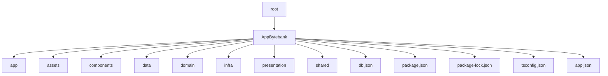

# Tech Challenge Fiap 3
##### Repositorio para mobile

## Tecnologias utilizadas no projeto

#### • Node version 20.19.0
#### • React Native
#### • Figma
#### • Firebase

---------------------------------------------------------------

# Orietações para execução do projeto

Para executar o projeto, siga os passos abaixo:

**instalação de dependencia abra o terminal e execute o comando abaixo**

- npm install

**Subida do projeto no expo abra o terminal e execute o comando abaixo**

- npm run start

*O projeto será executado na porta 8081*


Voce pode acessar via web na porta indicada , ou no aplicativo Expo dev . Instale o aplicativo no seu app strore e depois de instalado aponte a cammera do celular no qr code para que a aplicaçao [...]

Para que o app possa rodar dentro do celular , voce precisa pegar o ip da sua maquina 

apertando windows + r e depois digite no prompt ipconfig 

pegue o IPV4 correspondente siga o caminho


AppBytebank >> financeiro >> util.services.tsx


e coloque o ip da sua maquina na constante *const LOCAL_IP*

**Também é possível rodar o projeto via Emulador do VisualStudio**

- npm run start
- Opção "a" (Android)

Obs: É necessário ter o visual studo instalado e o emulador devidamente configurado em sua máquina.


**O projeto já possui um usuário criado para testes, para realizar o login, utilize o usuário de teste abaixo**

usuario: teste@email.com
senha: 123456

---

## Estrutura do projeto (correta)

Este repositório organiza o código dentro da pasta principal AppBytebank. Abaixo uma visão da estrutura real encontrada no repositório, com as pastas/arquivos principais.



Observação: não existe a pasta `src` neste projeto — o código está organizado dentro de `AppBytebank` seguindo uma separação por camadas (domain, presentation, infra, shared).

## Principais pastas e responsabilidades (mapeamento real)

- AppBytebank/app: ponto de entrada / configuração do app (expo/app.json relacionado)
- AppBytebank/presentation: telas e componentes de interface específicos da aplicação (equivalente à camada de UI)
- AppBytebank/components: componentes reutilizáveis (botões, inputs, headers) — geralmente usados pela camada presentation
- AppBytebank/shared: utilitários compartilhados, temas, estilos, constantes e wrappers que são usados por várias partes do app
- AppBytebank/domain: regras de negócio, modelos e possivelmente casos de uso (use-cases)
- AppBytebank/infra: implementação de infra (serviços, provedores, adaptadores, integração com APIs ou Firebase)
- AppBytebank/data: dados estáticos ou mapeamentos (pode conter fixtures ou helpers que alimentam o app)
- AppBytebank/assets: imagens, fontes e arquivos estáticos
- AppBytebank/db.json: arquivo de dados local usado como mock/fixture para desenvolvimento ou testes
- AppBytebank/package.json / package-lock.json / tsconfig.json: configurações do projeto e dependências

## Arquitetura e fluxos

O projeto segue uma separação por camadas (presentation, domain, infra, shared). A camada `presentation` consome casos de uso/serviços expostos por `domain`/`infra` e utiliza componentes de `components` e `shared` para renderizar a interface.

```mermaid
flowchart LR
  U[Usuário] --> P[presentation (telas)]
  P --> C[components/shared]
  P --> D[domain (casos de uso)]
  D --> I[infra (serviços/API/Firebase)]
  I --> DB[db.json / backend]
```

## Scripts úteis

- npm install: instala dependências
- npm run start: inicia o Metro/Expo (rodar na pasta AppBytebank conforme configuração)
- npm run android (se configurado): abre no emulador Android
- npm run ios (se configurado): abre no simulador iOS

Ajuste: alguns scripts podem depender da configuração local do Expo/React Native — verifique AppBytebank/package.json para a lista completa.

## Configuração do Firebase

Se o projeto depende do Firebase, verifique a implementação dentro de AppBytebank/infra (ou pasta equivalente). Para configurar o Firebase em sua máquina:

1. Crie um projeto no console do Firebase
2. Adicione um app (Android/iOS/Web) e copie as credenciais (apiKey, authDomain, projectId, etc.)
3. Coloque as credenciais no arquivo de configuração indicado em AppBytebank/infra/config (ou arquivo equivalente). NÃO commit essas chaves em repositórios públicos — use variáveis de ambiente quando possível.

## Variáveis de ambiente

- LOCAL_IP: IP da sua máquina para uso em chamadas locais (conforme instruções existentes)
- FIREBASE_API_KEY, FIREBASE_AUTH_DOMAIN, FIREBASE_PROJECT_ID, etc.: credenciais do Firebase

Recomendo criar um arquivo .env.local (adicionado ao .gitignore) com essas chaves em desenvolvimento.

## Testes e qualidade

- Se existirem testes (jest, testing-library), execute com: npm test
- Utilize linters (eslint, prettier) se estiverem configurados: npm run lint

## Boas práticas para contribuições

- Abra uma issue descrevendo a feature/bug antes de iniciar trabalho
- Crie branches de feature com nomes claros: feat/<descrição> ou fix/<descrição>
- Faça commits pequenos e com mensagens descritivas
- Adicione reviewers no PR e descreva o que foi alterado

## Observações adicionais

- Mantenha o arquivo AppBytebank/shared (ou o arquivo util.services.tsx indicado anteriormente) atualizado com o LOCAL_IP quando trabalhar com dispositivo físico
- Verifique a versão do Node indicada (20.19.0) para evitar incompatibilidades

## Contato / Suporte

Para dúvidas sobre o projeto, contate o mantenedor do repositório.

---

**O projeto já possui um usuário criado para testes, para realizar o login, utilize o usuário de teste abaixo**

usuario: teste@email.com
senha: 123456
